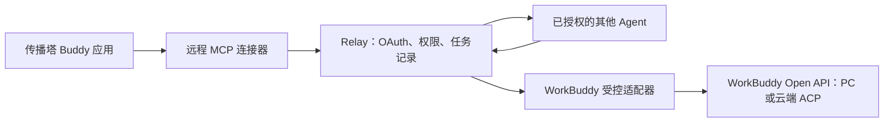

# 传播塔应用与远程 MCP 接入

这份指南覆盖原来缺少的应用接入层。`workbuddy-mcp` 是用户在 WorkBuddy 中安装/绑定的远程工具连接器；`workbuddy` CLI 包用于接收任务的常驻适配器和本地诊断。两者访问同一个 Relay，分别持有自己的身份和授权，不共享长期凭据。

## 完整关系



主控连接器 OAuth 只授权 Relay 工具；应用 Client ID/Secret 用于受控侧的 WorkBuddy Open API OAuth。这是两个授权流程。模式和胶囊是行为预设，不创建连接、安装工具或发放调用权限。

## 服务端私有配置

Client Secret 在开放平台创建应用时完整展示一次。当前应用的基础配置页只显示 ID、授权范围和回调地址，没有可见的 Secret 查看/重置入口；如果创建时未保存，须通过平台支持确认恢复或重置方式。不要把 Secret 放进连接器 ZIP、应用配置 ZIP、聊天或 Git。

在 `a2a-relay` 仓库运行以下命令，创建只属于服务器的 EnvironmentFile。命令生成强管理员凭据和持久加密密钥，不输出它们，也不会覆盖既有文件：

```bash
rtk proxy python3 scripts/workbuddy-config.py init --env /private/path/workbuddy.env --client-id ACTUAL_CLIENT_ID --agent-id chuanbota-workbuddy-cloud --mode cloud
rtk proxy python3 scripts/workbuddy-config.py check --env /private/path/workbuddy.env
```

用本地编辑器在该文件的 `WORKBUDDY_CLIENT_SECRET=` 后填写真实 Secret。校验仅检查配置结构，不证明平台已经授权。文件包含：

| 字段 | 用途 |
| --- | --- |
| `RELAY_MCP_ENABLED=true` | 启用远程 MCP、OAuth discovery 与授权服务 |
| `RELAY_ADMINTOKEN` | Relay 配对/权限管理的强管理员凭据 |
| `WORKBUDDY_CLIENT_ID` / `WORKBUDDY_CLIENT_SECRET` | 开放平台应用身份，仅 Relay 持有 |
| `WORKBUDDY_AGENT_ID` | 已配对受控适配器的准确 Agent ID |
| `WORKBUDDY_TOKEN_KEY` | 32字节随机数据的 Base64，加密上游令牌，跨部署保留 |
| `WORKBUDDY_SCOPES` | 云端、PC 或两者的完整 readable/invokable 权限对 |

`--mode desktop` 选择 PC 权限，`--mode both` 申请四个权限；适配器仍需明确选择 desktop 或 cloud 运行。不要因部署新版本而重新生成加密密钥。MCP 启用时，Relay 命令行启动拒绝不足32字符的管理员凭据。

## 部署 Relay 与接收服务

Relay 现在需要 Go 1.25+ 编译；发布包可包含 Linux 二进制，服务器运行时不需要 Go。依赖 SDK 为官方 `github.com/modelcontextprotocol/go-sdk v1.7.0`。

1. 将编译好的 Relay 放在 `/opt/chuanbota/relay/relay`。参考 `a2a-relay/deploy/relay.example.json` 填写真实 Redis 地址、认证及公共 HTTPS origin，保存到 `/etc/chuanbota/relay.json`。保留现有 Redis 数据及 Relay 权限。私有 EnvironmentFile 放在 `/etc/chuanbota/workbuddy.env`，权限0600，只交给 Relay 服务。
2. 按 `deploy/chuanbota-relay.service` 创建专用服务用户并安装 systemd unit。服务仅监听 `127.0.0.1:8020`，通过现有 HTTPS 反向代理访问。把 `deploy/nginx-workbuddy.conf` 中的 MCP、discovery 和 OAuth 路由合并到现有 server 中；保留已有 `/connect`、`/agents/`、`/pair`、`/pair/list`、`/pairing/`、`/admin/` 和 `/relay/` 路由。不要用示例覆盖现有站点。OAuth 路由关闭记录查询参数的访问日志。
3. 将 CLI 包解压到 `/opt/chuanbota/workbuddy` 并安装 Node.js 22+ 及包依赖。创建单独的 `chuanbota-connector` 用户和私有目录 `/var/lib/chuanbota-workbuddy`。为该用户设置 `A2A_CONNECTOR_CONFIG_DIR=/var/lib/chuanbota-workbuddy`、`A2A_CONNECTOR_INSTANCE=cloud` 后，用相同身份完成首次 setup：

```bash
rtk proxy /usr/bin/node /opt/chuanbota/workbuddy/cli.js setup --mode cloud --relay wss://dsh-relay.chuanbota.com/connect --agent-id chuanbota-workbuddy-cloud --name '传播塔云端受控'
rtk proxy /usr/bin/node /opt/chuanbota/workbuddy/cli.js auth status
```

这些命令必须在接收服务的用户和环境内执行，不要在管理员自己的 HOME 中创建另一套状态。确认 Agent ID 与服务器 `WORKBUDDY_AGENT_ID` 一致，在 `/pair` 核对确认码并批准。

二进制、目录所有者、依赖安装和回退顺序见 [部署包操作说明](../../deploy/workbuddy-install.md)。运行 `scripts/package-workbuddy-deployment.py` 可将两个 Linux 架构程序、两种连接器包和公开部署模板打包；脚本只接受明确列出的文件，不收集任何本地私有配置。

4. 同一用户、同一环境执行 `platform login`，由账号持有人在官方授权页面同意；再执行 `doctor`。首次 setup 启动了一个后台 runner，先 `stop`，然后安装 `a2a-connector/deploy/chuanbota-workbuddy.service`，由 systemd 运行前台 `workbuddy-a2a run`。正常运维用 systemd start/stop，不让系统服务与手动后台服务重叠。CLI 的 `run` 保留同一 PID/锁规则，退出释放锁；重启不会重新提交未知任务。

PC 模式使用同一个安装流程，换成 `--mode desktop` 并确保受控 PC 在线。云端适配器可以部署在服务器，执行本身不依赖 PC 在线。当前上游 OAuth 仍绑定一个明确的 `WORKBUDDY_AGENT_ID`，不要把它描述成多租户自动授权服务。

## 主控 OAuth 与权限

MCP 地址：`https://dsh-relay.chuanbota.com/mcp`。

服务提供标准 protected-resource/authorization-server discovery、公开客户端动态注册、PKCE S256、一次性授权码、受众绑定的短期 access token、轮换 refresh token、重放撤销和主动撤销。OAuth token 只用于 MCP，不会作为原始配对凭据接受。Redis 只存令牌哈希；刷新和兑换在 Redis 中原子完成，服务重启不丢授权记录。删除、暂停或轮换对应 Relay 身份会阻止其 MCP 访问。每个工具请求继续检查目标 ACL，撤销目标权限也会禁止读取其历史任务。

用户在 WorkBuddy 点击连接后：

1. MCP 客户端发现服务并注册，打开 Relay 授权页。
2. 授权页展示新建的 `wbmcp-...` 主控身份和确认码。管理员在 `/pair` 核对并批准；授权页的状态检查完成一次性配对兑换，使身份可在 `/pair/list` 中设置目标。
3. 管理员仅选择需要调用的目标。这个主控身份不需要运行入站隧道，管理列表显示 offline 并不代表 MCP 主控离线；其可调用目标的隧道需要在线。
4. 用户在原授权页确认，客户端得到 MCP OAuth token。没有目标权限时可以认证，但 `a2a_targets` 为空，不能派发任务。工具中不提供管理员操作，也不自动增加权限。

支持 WorkBuddy 私有协议回调 `workbuddy://workbuddy/mcp/connector:chuanbota-a2a/oauth/callback`、平台分配的 `oc_...` 连接器 ID 回调和精确注册的 HTTP loopback 回调。回调必须先精确注册，不能在授权时更换。拒绝 plain PKCE、重定向不匹配和其他资源的 token。默认只接受配置中的公共 Host、同源请求与无 Origin 的原生客户端；浏览器客户端来源须在 `mcpAllowedOrigins` 中明确配置。

## 绑定到 Buddy 应用

```bash
rtk proxy python3 scripts/package-workbuddy-mcp.py
```

该命令在 **a2a-connector** 根目录执行，生成 `dist/chuanbota-a2a-mcp-VERSION.zip`。这是提交 **连接器** 的 MCP+Skill 包，包含根目录 connector-meta.json、mcp.json、icon.svg 和 skills。不要传到 Buddy 应用的“静态资源包”。

开放平台的「发布管理 → 连接器 → 创建」是连接器入口。按页面要求提交，审核通过后，在 Buddy 应用中：

1. 「市场配置 → 连接器」选择真正的“传播塔任务协作”连接器。
2. 「首页配置 → 内置连接器」选择支持 OAuth 的这一个 MCP 连接器。
3. 预览中完成用户绑定，验证实际工具出现，之后再提交应用配置审核。模式和胶囊可调用这些工具，但提示词本身不代替安装/授权。

连接器审核和应用配置审核是平台的两个外部环节，生成 ZIP 不代表已通过。不能把市场里的 GitHub 等其他连接器当成我们自己的接入已经完成。退出应用编辑前导出应用配置 ZIP，避免未提交编辑丢失。

## 验证与完成条件

在 **a2a-relay** 根目录运行：

```bash
rtk proxy go test ./...
rtk proxy go test -race ./...
rtk proxy python3 scripts/check-workbuddy-deployment.py --base https://dsh-relay.chuanbota.com
```

跨仓库测试 `TestMCPRealWorkBuddyCloudChain` 会启动真实 Go Relay、官方 MCP SDK、Redis 测试服务、Node Connector 和云端适配器，完成两个 OAuth 流程、ACL、A2A journal 和 ACP SSE 到结果返回。只有 WorkBuddy 远端服务使用模拟接口，不会访问真实账户或消耗平台额度。单独检出 Relay、没有相邻 a2a-connector 或没有 Node 时，该跨仓库测试会明确跳过；发布验收要求本地联仓运行并确认它实际通过。

公开部署检查只检查 discovery、MCP 401 challenge 和回调响应，不证明 Secret、上游授权或受控端在线。只有以下项目全部完成，才能通知业务用户测试：服务已部署、应用真实 Secret 已配置、受控端 doctor 通过、MCP 连接并获得明确目标权限、连接器审核/应用绑定完成，并用真实账号获得实际执行结果。

规范来源：[WorkBuddy 连接器](https://open.workbuddy.cn/docs/connector)、[Buddy 应用内置连接器](https://open.workbuddy.cn/docs/buddy-app)、[MCP 授权规范](https://modelcontextprotocol.io/specification/2025-11-25/basic/authorization)。
