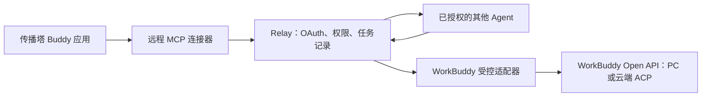

# 传播塔应用与远程 MCP 接入

这份指南覆盖原来缺少的应用接入层。`workbuddy-mcp` 是用户在 WorkBuddy 中安装/绑定的远程工具连接器；`workbuddy` CLI 包用于接收任务的常驻适配器和本地诊断。两者访问同一个 Relay，分别持有自己的身份和授权，不共享长期凭据。

## 完整关系



主控连接器 OAuth 只授权 Relay 工具；应用 Client ID/Secret 用于受控侧的 WorkBuddy Open API OAuth。这是两个授权流程。模式和胶囊是行为预设，不创建连接、安装工具或发放调用权限。

## 现有部署直接升级

新版 Relay 命令行服务默认启用 MCP。继续使用服务器已经加载的 `manifest/config/config.json`，不需要额外配置 `RELAY_MCP_ENABLED=true`，也不需要更换已有管理员凭据。只有明确设置 `relay.mcpEnabled=false` 或 `RELAY_MCP_ENABLED=false` 才关闭；已有非空环境变量仍优先。

程序现在读取现有 `workbuddy.clientId` 和 `workbuddy.clientSecret`。未配置的接收端 ID 默认 `chuanbota-workbuddy-cloud`，授权范围默认 PC 与云端的四个完整权限；均与本项目目前的应用配置一致。仍只允许这个准确的受控身份获取上游令牌，不会自动授权全部 Agent。

令牌加密密钥优先沿用 `workbuddy.tokenKey` 或 `WORKBUDDY_TOKEN_KEY`。未提供时，程序从应用 Secret 派生用途隔离、重启稳定的32字节密钥，无需额外挂载密钥文件。使用派生密钥时，应用 Secret 轮换后需要重新完成上游授权。已经使用显式密钥的部署必须保留原密钥。

JSON 中的应用凭据属于服务端私有数据，不能进入公开文件、静态包或连接器包。无需把原有 JSON 凭据迁移到环境变量才能运行。`scripts/workbuddy-config.py` 和私有 EnvironmentFile 是可选运维工具，不再是启用 MCP 的前提。

## 自动发布静态发现文件

每次启动会使用实际 `relay.publicUrl` 自动更新：

```text
程序工作目录/.well-known/oauth-protected-resource/mcp
程序工作目录/.well-known/oauth-authorization-server
程序工作目录/manifest/public/.well-known/oauth-protected-resource/mcp
程序工作目录/manifest/public/.well-known/oauth-authorization-server
```

它们仅含公开地址和协议能力，和 HTTP 动态发现接口共用同一份定义。更新时仅写这两个文件，保留已有 `.well-known/acme-challenge/`。文件系统只读时记录提示，服务仍正常提供动态接口。

发布流程也可以在打包前调用程序导出到发布根目录，此命令不连接 Redis，也不要求应用密钥或管理员凭据：

```bash
rtk proxy ./a2a-relay -config deploy/relay.example.json -export-static /path/to/release-webroot
```

自动生成发生在程序能访问的文件系统内。若现有发布把工作目录或 `manifest/public` 作为站点目录，发现文件会随之更新；Go 进程不能写入未挂载的宿主机 Nginx 目录。是否已对公网可见需用公开检查确认，不能把容器内生成成功等同于 Nginx 已读取。

静态内容应以 `application/json` 返回。`a2a-relay/deploy/workbuddy-static/` 和 `dist/workbuddy-discovery-static.zip` 保留为独立发布材料，内含可与证书规则共存的静态路由示例。所有 Nginx 文件都是可选参考，不会由程序擅自改写服务器配置。

## 发布后诊断与接收端

`GET /oauth/workbuddy/health` 或已存在的回调地址加 `?relay_health=1` 可检查新程序，只返回 `mcpEnabled`、`workbuddyConfigured` 等公开状态，不返回应用 Secret、令牌、管理员凭据或 Agent 清单。

在 Relay 仓库运行：

```bash
rtk proxy python3 scripts/check-workbuddy-deployment.py --base https://dsh-relay.chuanbota.com
```

新版默认配置中，无令牌 `/mcp` 应返回401及发现 challenge。若新 health 已显示 MCP 开启而公网 `/mcp` 仍404，应定位外层转发或不同 upstream；只有旧接口响应时，需要核对实际运行的程序版本。这类网络问题无法由客户端凭空确定服务器文件路径。

接收端继续使用现有 CLI 的 desktop/cloud 模式、配对、`platform login` 和 `doctor`。接收端 ID 须与 Relay 默认的 `chuanbota-workbuddy-cloud` 或显式配置相同。真实账号授权和管理员目标 ACL 仍是必要步骤，程序不会代替用户批准。

## 主控 OAuth 与权限

MCP 地址：`https://dsh-relay.chuanbota.com/mcp`。

服务提供标准 protected-resource/authorization-server discovery、公开客户端动态注册、PKCE S256、一次性授权码、受众绑定的短期 access token、轮换 refresh token、重放撤销和主动撤销。OAuth token 只用于 MCP，不会作为原始配对凭据接受。Redis 只存令牌哈希；刷新和兑换在 Redis 中原子完成，服务重启不丢授权记录。删除、暂停或轮换对应 Relay 身份会阻止其 MCP 访问。每个工具请求继续检查目标 ACL，撤销目标权限也会禁止读取其历史任务。

用户在 WorkBuddy 点击连接后：

1. MCP 客户端发现服务并注册，打开 Relay 授权页。
2. 授权页展示新建的 `wbmcp-...` 主控身份和确认码。管理员在 `/pair` 核对并批准；授权页的状态检查完成一次性配对兑换，使身份可在 `/pair/list` 中设置目标。
3. 管理员仅选择需要调用的目标。这个主控身份不需要运行入站隧道，管理列表显示 offline 并不代表 MCP 主控离线；其可调用目标的隧道需要在线。
4. 用户在原授权页确认，客户端得到 MCP OAuth token。没有目标权限时可以认证，但 `a2a_targets` 为空，不能派发任务。工具中不提供管理员操作，也不自动增加权限。

支持 WorkBuddy 私有协议回调 `workbuddy://workbuddy/mcp/connector:chuanbota-a2a/oauth/callback`、平台分配的 `oc_...` 连接器 ID 回调和精确注册的 HTTP loopback 回调。回调必须先精确注册，不能在授权时更换。拒绝 plain PKCE、重定向不匹配和其他资源的 token。默认只接受配置中的公共 Host、同源请求与无 Origin 的原生客户端；浏览器客户端来源须在 `mcpAllowedOrigins` 中明确配置。

## 绑定到 Buddy 应用

```bash
rtk proxy python3 scripts/package-workbuddy-mcp.py
```

该命令在 **a2a-connector** 根目录执行，生成 `dist/chuanbota-a2a-mcp-VERSION.zip`。这是提交 **连接器** 的 MCP+Skill 包，包含根目录 connector-meta.json、mcp.json、icon.svg 和 skills。不要传到 Buddy 应用的“静态资源包”。

开放平台的「发布管理 → 连接器 → 创建」是连接器入口。按页面要求提交，审核通过后，在 Buddy 应用中：

1. 「市场配置 → 连接器」选择真正的“传播塔任务协作”连接器。
2. 「首页配置 → 内置连接器」选择支持 OAuth 的这一个 MCP 连接器。
3. 预览中完成用户绑定，验证实际工具出现，之后再提交应用配置审核。模式和胶囊可调用这些工具，但提示词本身不代替安装/授权。

连接器审核和应用配置审核是平台的两个外部环节，生成 ZIP 不代表已通过。不能把市场里的 GitHub 等其他连接器当成我们自己的接入已经完成。退出应用编辑前导出应用配置 ZIP，避免未提交编辑丢失。

## 验证与完成条件

在 **a2a-relay** 根目录运行：

```bash
rtk proxy go test ./...
rtk proxy go test -race ./...
rtk proxy python3 scripts/check-workbuddy-deployment.py --base https://dsh-relay.chuanbota.com
```

跨仓库测试 `TestMCPRealWorkBuddyCloudChain` 会启动真实 Go Relay、官方 MCP SDK、Redis 测试服务、Node Connector 和云端适配器，完成两个 OAuth 流程、ACL、A2A journal 和 ACP SSE 到结果返回。只有 WorkBuddy 远端服务使用模拟接口，不会访问真实账户或消耗平台额度。单独检出 Relay、没有相邻 a2a-connector 或没有 Node 时，该跨仓库测试会明确跳过；发布验收要求本地联仓运行并确认它实际通过。

公开部署检查只检查 discovery、MCP 401 challenge 和回调响应，不证明 Secret、上游授权或受控端在线。只有以下项目全部完成，才能通知业务用户测试：服务已部署、应用真实 Secret 已配置、受控端 doctor 通过、MCP 连接并获得明确目标权限、连接器审核/应用绑定完成，并用真实账号获得实际执行结果。

规范来源：[WorkBuddy 连接器](https://open.workbuddy.cn/docs/connector)、[Buddy 应用内置连接器](https://open.workbuddy.cn/docs/buddy-app)、[MCP 授权规范](https://modelcontextprotocol.io/specification/2025-11-25/basic/authorization)。
