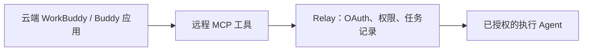

# MCP 主控与 Buddy 应用接入

云端 WorkBuddy 或 Buddy 应用通过远程 MCP 工具发现已授权的 Agent、派发任务、查询进度并读取结果。主控使用当前 MCP 连接提供的工具完成协作。



## 连接 MCP

在 WorkBuddy 的 MCP 连接入口使用服务地址：

[https://dsh-relay.chuanbota.com/mcp](https://dsh-relay.chuanbota.com/mcp)

支持 `mcpServers` 配置的客户端可使用：

```json
{
  "mcpServers": {
    "chuanbota-a2a": {
      "type": "streamableHttp",
      "url": "https://dsh-relay.chuanbota.com/mcp",
      "timeout": 30000
    }
  }
}
```

其他客户端使用其原生 MCP 配置格式，服务地址保持一致。企业控制台的「Agent 管理 → 接入 Agent → MCP 主控」提供完整配置指令、JSON 和地址复制，也可直接打开 `/console#mcp-setup`。

从客户端的连接或登录入口发起 OAuth。用户登录 Relay，选择所属企业并确认授权；Relay 创建或复用该成员的个人 MCP Controller。确认当前 Controller 的准确 Agent ID，显示名称不能代替身份标识。认证使用客户端原生 OAuth 与 PKCE，由 MCP 连接管理凭据；不要在提示词或共享配置中填写令牌、密码或密钥。

## 授予目标权限

管理员在 `/console` 的**目标 Agent**行打开「谁能访问」，选择当前 MCP Controller 为机器调用方并授予所需动作。个人 Controller 的机器授权还需与绑定成员的有效成员/用户组权限取交集。管理员身份本身不代替任务使用权限。

- `discover`：发现目标并读取能力卡。
- `invoke`：向目标派发任务。
- `task_read`：读取该 Controller 自己创建的任务和交付物。
- 取消、审批回复和放弃跟踪分别需要相应动作权限。

OAuth 连接成功后仍需检查目标权限。`a2a_targets` 为空时，核对企业、Controller 身份、目标状态及权限交集。工具已注册或能够读取能力卡，均不代表拥有全部任务操作权限。权限变更由管理员在控制台完成。

## 任务、结果与交付物

1. 用 `a2a_targets` 获取准确目标 ID，按 `nextPage` 翻页直到 0；用 `a2a_agent` 查看目标的实际能力。
2. 获得业务指令后，用 `a2a_send` 派发一次，保留该指令的稳定 `messageId` 及返回的任务、上下文和收据 ID。连接检查本身不授权真实业务测试。
3. 用 `a2a_task` 查询原任务；超时或断线后用原 `relayRequestId` 调用 `a2a_request` 恢复收据。未知结果不代表未执行，不更换 ID 重发同一指令。
4. 用 `a2a_tasks` 分页查询当前 Controller 的任务。保留原调用身份与过滤条件；空列表不证明先前的未知派发未执行。
5. 用当前连接已提供的 `a2a_artifact` 读取任务登记的交付物，核对原目标、任务、产物 ID、大小和 SHA-256。文件交付成功与业务任务完成分别判断。

`input-required` 需要用户输入或检查，不能当作完成。审批回复、取消或放弃跟踪按用户明确决定执行。目标的账号或执行环境不可用时，报告返回的原因，并由目标负责人在控制台处理。

文件交付能力以目标能力卡为准。只有本地路径时，可在用户授权的交付范围内向同一目标发送仅交付现有文件的后续指令，由目标使用自己的能力完成交付；保留原任务关联，不重新执行原业务。读取交付物继续使用原 MCP Controller 身份。超过工具大小限制、文件过期或校验失败时，报告具体限制。

## 绑定到 Buddy 应用

在源码项目根目录生成 MCP 提交包：

```bash
rtk proxy python3 scripts/package-workbuddy-mcp.py
```

生成 `dist/chuanbota-a2a-mcp-VERSION.zip`，包含平台要求的 `connector-meta.json`、`mcp.json`、图标和主控 Skill。

1. 在开放平台「发布管理 → 连接器 → 创建」提交 MCP 包。该包应提交到连接器入口。
2. 审核并发布后，在 Buddy 应用「市场配置 → 连接器」选择“传播塔任务协作”。
3. 在「首页配置 → 内置连接器」选择同一个支持 OAuth 的 MCP 连接器。
4. 预览中完成用户连接和授权，确认实际工具出现、目标权限生效后，再提交应用配置审核。

模式和胶囊是行为预设，工具能力来自实际连接与授权。生成 ZIP、连接器发布和应用审核分别验证；退出应用编辑前导出配置，避免未提交编辑丢失。

## 服务端公开检查

在 Relay 项目根目录运行只读检查：

```bash
rtk proxy python3 scripts/check-workbuddy-deployment.py --base https://dsh-relay.chuanbota.com
```

公开检查验证 OAuth 发现、MCP 认证入口及公开回调，不读取用户凭据或派发任务。`mcpDeploymentReady` 为真只证明接入入口就绪。真实验收还需确认：用户 MCP 连接成功、能发现明确授权的目标，并在用户授权的业务范围内取得实际执行结果。

服务部署与 OAuth 发现接口的运维细节见 [Relay 服务说明](../../../a2a-relay/README.md)。

规范来源：[WorkBuddy 连接器](https://open.workbuddy.cn/docs/connector)、[Buddy 应用内置连接器](https://open.workbuddy.cn/docs/buddy-app)、[MCP 授权规范](https://modelcontextprotocol.io/specification/2025-11-25/basic/authorization)。
